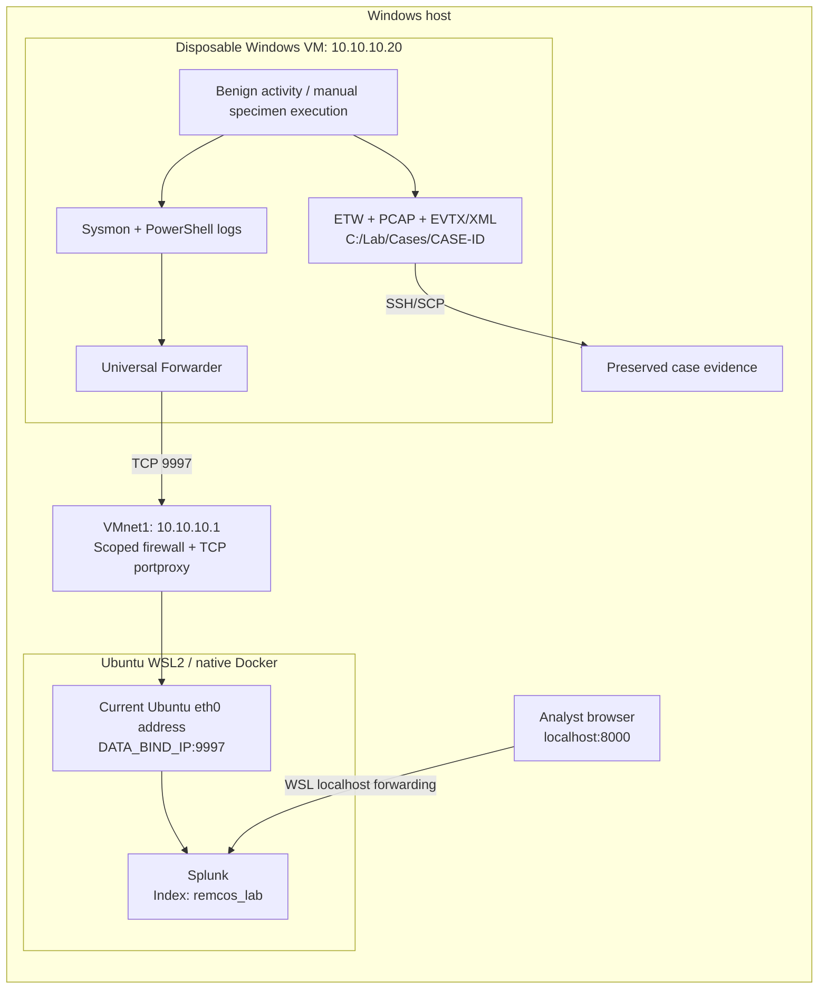

# Inside Remcos: Windows Telemetry & Detection Lab

A Windows malware-analysis lab for studying Remcos 4.9.3 Pro, correlating host/network evidence, and developing explainable YARA and Splunk detections. A comparison with Remcos 7.0.4 Pro is planned.

**Validated:** Splunk ingestion, Sysmon/PowerShell forwarding, benign ETW/PCAP collection, guest reboot recovery, and a Remcos 4.9.3 Pro file/buffer YARA experiment with results reviewed in Splunk. **Pending:** specimen comparison, broader detection evaluation, and Elastic/Fleet/Defend deployment.

## Architecture



Sysmon and PowerShell logs are forwarded live. Kernel-Process ETW traces and PCAPNG files are collected locally and preserved per case; arbitrary ETW-to-Splunk forwarding is not configured.

## Requirements

- Windows host with WSL2, VMware Workstation, and a host-only network.
- Ubuntu with native Docker Engine, Compose v2, Bash, and Python 3.10+.
- Disposable Windows VM with Administrator PowerShell 5.1, Sysmon, Splunk Universal Forwarder, and Wireshark/Npcap. OpenSSH is needed for SCP transfer.
- Sufficient resources for the guest and one SIEM stack. The reference host has 16 GB RAM; Splunk has a 4 GB container limit. Run Splunk and Elastic as separate phases.

Commands are labeled **HOST**, **SIEM**, or **VM**. Use these working locations:

| Role | Repository location |
| --- | --- |
| HOST / PowerShell | Windows checkout; run host commands from its repository root |
| SIEM / Ubuntu Bash | `~/remcos-soc-lab` |
| VM / Administrator PowerShell | `C:\Lab\remcos-soc-lab`; only scripts/configuration are needed here |

## Networking

Reference topology: **VMware VMnet1, host-only, `10.10.10.0/24`**.

| Setting | Value / purpose |
| --- | --- |
| `LAB_SERVER_IP` | `10.10.10.1`: host address used by the endpoint |
| `AnalysisVmIp` | `10.10.10.20`: disposable Windows VM |
| `DATA_BIND_IP` | Current Ubuntu eth0 IPv4 address; discover after WSL restarts |
| Guest connectivity | Static `/24`; no default gateway/DNS; NAT/bridged adapters disconnected |

```text
VM:10.10.10.20 -> HOST:10.10.10.1:9997 -> WSL:CURRENT_ETH0_IP:9997 -> Splunk
```

| Port | Purpose | Exposure / status |
| --- | --- | --- |
| TCP 9997 | Splunk event receiver | Host-only address -> Ubuntu data bind; active |
| TCP 8000 | Splunk Web | Ubuntu loopback; HOST browser via `localhost` |
| TCP 22 | VM SSH/SCP | HOST -> guest; verified host key required |
| TCP 8220 / 9200 | Future Fleet / Elasticsearch | Host forwarding prepared; backends not deployed |
| TCP 5601 / 19200 | Future Kibana / analyst Elasticsearch API | Ubuntu loopback; not running |

Host rules permit the guest's collector TCP ports and block its other TCP/UDP access to the host-only IPv4 address. This scope does not cover every host interface/protocol. Splunk 9997 uses plain TCP inside the private lab; the web UI uses HTTP on loopback.

## Setup

### 1. Initialize Ubuntu settings

For a fresh Ubuntu checkout, clone into the working directory expected by this guide. With Docker/Compose installed:

**SIEM / Ubuntu Bash**

```bash
git clone https://github.com/Dashlane04/remcos-lab.git ~/remcos-soc-lab
cd ~/remcos-soc-lab
bash scripts/start-siem.sh --stack splunk --check-only
```

This creates a missing `infra/.env` with generated credentials and validates Compose without starting containers. Existing settings are preserved.

### 2. Configure host-to-WSL forwarding

Set VMnet1's host address to `10.10.10.1/24`, configure the guest as `10.10.10.20/24`, and disconnect its other network adapters. Then run from the Windows repository root:

**HOST / Administrator PowerShell**

```powershell
$linuxUser = (wsl.exe -d Ubuntu -- id -un).Trim()
$network = @{
    Distro = 'Ubuntu'
    LinuxLabRoot = "/home/$linuxUser/remcos-soc-lab"
    HostAdapter = 'VMware Network Adapter VMnet1'
    AnalysisVmIp = '10.10.10.20'
}
.\scripts\Configure-HostNetworking.ps1 @network
```

The script discovers Ubuntu eth0, updates `LAB_SERVER_IP`/`DATA_BIND_IP`, and refreshes scoped forwarding/firewall rules. Adapt distro, repository path, and adapter name if needed. It does not configure the guest. Repeat this step after a WSL address change, then restart the selected SIEM through the launcher.

### 3. Configure Windows sensors and forwarding

Install vendor tools during VM preparation. Copy the repository's `scripts/` and `configs/` to `C:\Lab\remcos-soc-lab`; keep server credentials and private keys off the guest.

**VM / Administrator PowerShell — fresh Sysmon installation**

```powershell
Set-Location C:\Lab\remcos-soc-lab
Get-AuthenticodeSignature C:\Lab\Tools\Sysmon64.exe
C:\Lab\Tools\Sysmon64.exe -accepteula -i .\configs\sysmon\sysmon-lab.xml
```

Verify the signature before installation. For an existing Sysmon service, apply the policy with `-c` instead of `-i`. Enable Windows PowerShell script-block logging and its Operational channel as described in [endpoint setup](docs/setup/04-windows-endpoint.md).

After installing Universal Forwarder, apply the lab inputs and receiver:

**VM / Administrator PowerShell**

```powershell
Set-Location C:\Lab\remcos-soc-lab
$ufConfig = 'C:\Program Files\SplunkUniversalForwarder\etc\apps\remcos_lab\local'
New-Item -ItemType Directory -Path $ufConfig -Force | Out-Null
foreach ($name in @('inputs.conf','limits.conf')) {
    Copy-Item ".\configs\splunk\forwarder\$name" -Destination $ufConfig
}
@'
[tcpout]
defaultGroup = remcos_lab
[tcpout:remcos_lab]
server = 10.10.10.1:9997
'@ | Set-Content -LiteralPath "$ufConfig\outputs.conf" -Encoding ASCII
Restart-Service SplunkForwarder
```

Inputs forward Sysmon and Windows PowerShell XML to `remcos_lab`, resuming from saved checkpoints. The lab throughput setting removes the default UF cap. Security input is disabled. Sysmon ImageLoad/ProcessAccess are disabled in the supplied policy; file-create coverage is filtered. Record policy changes when comparing runs.

### 4. Start Splunk

**SIEM / Ubuntu Bash**

```bash
cd ~/remcos-soc-lab
bash scripts/start-siem.sh --stack splunk --live
```

Open **[Splunk Web](http://localhost:8000)** on the HOST. Log in as `admin` with `SPLUNK_PASSWORD` from Ubuntu's private `infra/.env`. Select the **Remcos Lab** app for supplied field extractions/macros. Persistent configuration and indexed data reside in Docker named volumes.

## Capture and verify

Confirm the guest has no IPv4/IPv6 default route and only the intended host-only adapter is connected. Use a fresh case ID. Select the private adapter's current number from dumpcap; numbers can change after adapter changes.

**VM / Administrator PowerShell**

```powershell
Set-Location C:\Lab\remcos-soc-lab
Get-Service Sysmon64,SplunkForwarder
Get-NetRoute | Where-Object DestinationPrefix -in @('0.0.0.0/0','::/0')
& 'C:\Program Files\Wireshark\dumpcap.exe' -D
$captureInterface = [int](Read-Host 'Private adapter number from dumpcap output')
$case = @{
    CaseId = 'BASE-001'
    Forwarding = 'Splunk'
    SiemAddress = '10.10.10.1'
    CaptureInterface = $captureInterface
    ObservationSeconds = 180
    BaselineSeconds = 15
}
.\scripts\Start-LabCollection.ps1 @case
```

The generic collector requires manual network verification and selection of the intended capture adapter.

After **READY**, generate harmless activity in a second VM PowerShell terminal:

```powershell
Set-Location C:\Lab\remcos-soc-lab
.\scripts\Invoke-BenignWorkload.ps1 -DurationSeconds 60
```

In **Splunk / Remcos Lab**, select the collection interval and replace the marker placeholder with the exact value printed by the collector:

```spl
index=remcos_lab sourcetype="XmlWinEventLog:Microsoft-Windows-Sysmon/Operational" "REMCOS_LAB_REPLACE_WITH_RUN_MARKER"
| table _time host EventCode Image CommandLine ProcessGuid
```

READY and TCP reachability do not prove delivery; verify the indexed marker. For specimen cases, follow [specimen collection](docs/setup/06-specimen-collection.md): verify the extracted payload, supply `-EvidenceType actual-malware -SamplePath ... -ExpectedSampleSha256 ...`, and execute manually inside the VM. Collection scripts hash the supplied file but never launch it.

## Evidence and recovery

Cases are written to `C:\Lab\Cases\<CASE-ID>`:

```text
run.json / integrity.json     # metadata, status, UTC boundaries, file hashes
windows/                      # EVTX/XML exports and channel manifest
etw/                          # Kernel-Process ETL, decoded XML, loss summary
network/                      # PCAPNG and dumpcap logs
```

Review errors/source gaps, packet drops, and ETW loss. Preserve failed/partial runs. Pull evidence and verify hashes before snapshot rollback; allow buffered forwarding to drain first.

**HOST / PowerShell — repository root, after verifying the VM SSH host key**

```powershell
$vmUser = Read-Host 'VM SSH user'
$caseDestination = '.\data\raw\cases\BASE-001'
if (Test-Path -LiteralPath $caseDestination) { throw 'Choose a fresh destination.' }
New-Item -ItemType Directory -Path '.\data\raw\cases' -Force | Out-Null
scp.exe -o StrictHostKeyChecking=yes -r "${vmUser}@10.10.10.20:C:/Lab/Cases/BASE-001" '.\data\raw\cases'
if ($LASTEXITCODE -ne 0) { throw 'Evidence transfer failed.' }
```

Use [evidence handling](docs/setup/07-evidence-and-detection.md) for integrity verification, normalization, and imports. Offline JSON copies use `sourcetype=remcos:json` with `labels.case_id`; scope searches to avoid double-counting live and replayed events. ETW normalization requires a compatible, tested XML adapter.

**SIEM / Ubuntu Bash — stop without deleting data**

```bash
bash scripts/start-siem.sh --stack splunk --stop
```

Restore a validated clean guest snapshot between experiments. Guest snapshots do not back up Ubuntu's SIEM data. After WSL restarts, refresh networking and rerun the launcher. On a constrained host, stop Splunk before the optional [Elastic/Fleet phase](docs/setup/03-siem-services.md).

## YARA: Remcos 4.9.3 Pro

The [YARA rules and validation guide](detections/yara/README.md) target the **specific older Remcos 4.9.3 Pro specimen** analyzed in this lab:

```text
SHA-256: 0af76f2897158bf752b5ee258053215a6de198e8910458c02282c2d4d284add5
```

| Rule | Input and scope |
| --- | --- |
| `Remcos_493Pro_Settings_RC4_x86` | Experimental native x86 file rule combining the 4.9.3 Pro version, parsed SETTINGS resource, and reviewed RC4 KSA bytes |
| `Remcos_493_Case_DecodedConfig_IOCs` | Case-specific decoded-content indicator; also matches analyst notes containing all four IOCs |

**Coverage of Remcos 7.0.4 Pro, other builds, packed delivery files, and process memory has not been established.** Only one independent malware specimen was tested; a renamed copy is the same specimen.

The recorded read-only validation used yara-python 4.5.4: **134 inputs, 268 rule evaluations, zero scan errors, and zero expectation failures**. The reference set was local OS files from a previously exposed VM, so these results do not establish a population false-positive rate. [Validation summary](detections/yara/validation-summary.json).

YARA runs in the disposable Windows VM. Splunk ingests its JSON scan metadata through the existing `.ndjson` monitor; it does not scan the sample itself. [R4](detections/splunk/R4-yara-native-match.spl) displays the native-file match, [R5](detections/splunk/R5-yara-validation-coverage.spl) checks evaluation coverage, and [R6](detections/splunk/R6-yara-sysmon-hash-correlation.spl) correlates the later file scan with an earlier Sysmon process-start hash. These queries contain the recorded run's IDs and time bounds; update them for a new run.

## Repository

| Path | Contents |
| --- | --- |
| `infra/` | Compose profiles and local settings bootstrap |
| `configs/` | Sysmon policy and Splunk server/forwarder configuration |
| `scripts/` | Network refresh, startup, capture, export, normalization and import |
| `detections/` | Remcos 4.9.3 Pro YARA prototypes, validation guide, SPL queries and Elastic hunts |
| `fixtures/`, `tests/` | Synthetic checks and local tests |
| `templates/` | Sample/run manifests, timelines and investigation reports |
| `data/`, `evidence/` | Private raw/derived evidence; excluded from Git |

[Full setup chain](docs/SETUP.md) · [Comparison protocol](docs/08-comparative-traffic-telemetry-protocol.md) · [Sample provenance](docs/10-sample-provenance.md) · [Sources](docs/SOURCES.md)

Keep credentials, keys, raw evidence and malware binaries out of published material. Behavior hunts are experimental and do not independently establish Remcos attribution.
